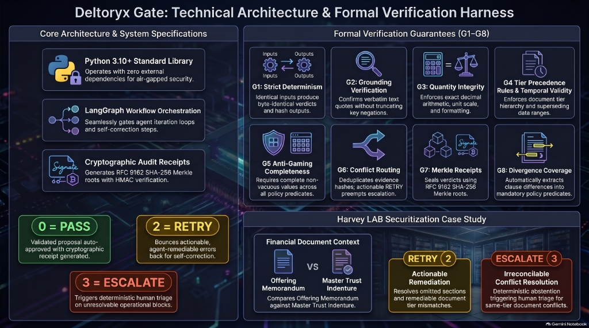

# Deltoryx Gate (`deltoryx-gate`) · Deterministic Verification & Authorization Harness for AI Agents

**The deterministic verification, abstention, and authorization harness for AI agents operating in a bounded domain.** *(Formerly ClaimLayer — Python module `deltoryx_gate`, backwards-compatible with `claimlayer`.)*

AI agents reason and propose actions fast, yet teams still spend most of their time manually cross-checking citations, numbers, exceptions, and amendments—because a single dropped proviso or ungrounded figure can trigger a bad authorization.

**Deltoryx Gate** is a zero-dependency Python library (pure stdlib) that serves as the **epistemic and policy base layer** for domain agents: the agent proposes structured claims tied to exact source spans, and Deltoryx Gate deterministically governs what enters the ledger, detects its own gaps, and decides whether an operation can proceed:

```text
Agent Proposal + Exact Citations
  ──► [1. Epistemic Integrity]   (Schema, condition_status, span fidelity, read completeness, pending conditions)
  ──► [2. Authorization Policy]    (Precedence, exceptions, Q_g support/margin, numeric bounds, coverage)
        ├── PASS     ──► Authorized to proceed + SHA-256 Merkle receipt (0 human wait)
        ├── RETRY    ──► Actionable gap / grounding error bounced to Agent (Self-corrects automatically)
        └── ESCALATE ──► Abstains & escalates ONLY on genuine conflicts, pending conditions, or policy caps
```

> **What Deltoryx Gate is (and isn't):** Deltoryx Gate is **not** a general agent orchestrator or open-ended prose judge. It is the **domain-grounded verification harness**: you declare a domain's semantic contract (`Vocabulary`, conditions, scopes, clause relations, and `AcceptancePolicy`), and Deltoryx Gate enforces that your agent cannot authorize an action unless both the evidence and the policy allow it.



### Video Walkthrough

[](https://youtu.be/F6bApAPaLI8)

▶ **[Watch the Deltoryx Gate walkthrough on YouTube](https://youtu.be/F6bApAPaLI8)**

---

## 1. Clone & Verify in 60 Seconds

`claim-layer` uses **only the Python 3.10+ standard library** (`hashlib`, `sqlite3`, `re`, `decimal`, `dataclasses`, `json`).

```bash
git clone https://github.com/mathmentorAI/claim-layer.git
cd claim-layer

# Option A: Editable install (recommended)
pip install -e .

# Option B: Run directly from source with zero pip installs
export PYTHONPATH="$PWD/src"

# 1. Run formal invariant, sandbox E2E, metamorphic & 137-case adversarial re-audit tests
pytest -v

# 2. Run the 200-task parameterized routing & throughput simulation (~17ms total)
python3 benchmarks/verification_bottleneck_bench.py

# 3. Run the Harness² × Harvey LAB Case 1 securitization replay (<2ms, 0 API keys)
python3 examples/harness2_securitization/replay_om_vs_indenture.py
```

---

## 2. How to Implement ClaimLayer in Your Project

### Fastest Way · Let Your AI Coding Agent Wire It Automatically (`Skill`)

`claim-layer` ships with an interactive onboarding skill (**[`skills/integrate-claimlayer/`](./skills/integrate-claimlayer/SKILL.md)**) that inspects your codebase, asks 3 short domain questions, wires `verify()` into your agent loop, and generates a smoke test:

```bash
# Claude Code
mkdir -p /path/to/your-project/.claude/skills && cp -R skills/integrate-claimlayer /path/to/your-project/.claude/skills/

# Antigravity / Codex / Agent-Skills compatible IDEs
mkdir -p /path/to/your-project/.agents/skills && cp -R skills/integrate-claimlayer /path/to/your-project/.agents/skills/
```

Then ask your coding assistant: ***"Use `integrate-claimlayer` to add ClaimLayer verification to my agent."***

---

### Manual Integration Paths

Keep your existing LLM (`Claude`, `GPT`, `Gemini`), prompts, and RAG pipeline unchanged. Choose whichever integration matches your stack (full reference & error code catalog in **[`docs/IMPLEMENTATION_GUIDE.md`](./docs/IMPLEMENTATION_GUIDE.md)**):

### Path A · Python Agent Self-Correction Loop (OpenAI / Anthropic / LangGraph)

Ask your agent (via tool-calling or Structured Outputs) to return structured `Assertion` items alongside its draft, and gate completion inside a standard `for` / `while` loop:

```python
from claimlayer import Assertion, FactRecord, Ledger, Policy, Source, verify_receipt

# 1. Register your governing documents & precedence rules once
ledger = Ledger(
    db_path=".claimlayer.sqlite",  # Optional SQLite persistence (omit for pure in-memory)
    sources=[
        Source(
            id="msa_2024",
            text="Section 4.1: ACME shall pay all undisputed invoices within 45 days.",
            tier="standard",          # rank = 50
        ),
        Source(
            id="amendment_2026",
            text="Section 4.1 is hereby amended: ACME shall pay all undisputed invoices within 30 days.",
            tier="authoritative",     # rank = 100
            supersedes=["msa_2024"],
        ),
    ],
    facts=[
        FactRecord(
            subject="ACME",
            predicate="payment_terms",
            value="30 days",
            source_id="amendment_2026",
            quote="ACME shall pay all undisputed invoices within 30 days.",
        )
    ],
)
policy = Policy(policy_id="contract_ops", min_tier_rank=50, required_predicates=["payment_terms"])

# 2. Gate your agent's tool call / structured output in <1 ms
for attempt in range(3):
    proposal = run_your_llm_agent(messages)  # Returns list of Assertion dicts

    verdict = ledger.verify(assertions=proposal, policy=policy, agent_id="contract-agent")

    if verdict.status == "PASS":
        assert verify_receipt(verdict, ledger=ledger, policy=policy)  # Re-run verification against trusted state
        break                           # Auto-approved — 0 seconds of human wait!

    if verdict.status == "RETRY":
        # Bounce exact errors back to the LLM — 0 human attention wasted!
        errors = "\n".join(f"- [{i.code}] {i.message} -> {i.remediation}" for i in verdict.issues)
        messages.append({"role": "user", "content": f"Fix verification errors:\n{errors}"})
        continue

    if verdict.status == "ESCALATE":
        # Wake a human ONLY when equally authoritative documents genuinely conflict
        send_to_human_triage(verdict.conflicts)
        break
```

> **Comparing Two Documents (Redlines, Offering Memorandum vs. Indenture)?**
> Call `policy, divergences = build_comparison_policy(primary_doc, secondary_doc)` to automatically populate `policy.required_predicates` with every section where numbers or clauses diverge so the agent cannot stop early.

---

### Path B · MCP Server (`Claude Code`, `Cursor`, `OpenCode`, `Claude Desktop`)

Expose `register_source`, `verify_proposal`, and `check_escalation` over `stdio` JSON-RPC 2.0 by adding this to `.mcp.json` or `claude_desktop_config.json`:

```json
{
  "mcpServers": {
    "claimlayer": {
      "command": "python3",
      "args": ["-m", "claimlayer.cli", "mcp", "--db", ".claimlayer.sqlite"],
      "env": {
        "PYTHONPATH": "/absolute/path/to/claim-layer/src"
      }
    }
  }
}
```

Then add to your `CLAUDE.md` or system prompt:
> *"Before finalizing any deliverable, register governing documents with `register_source` and verify all quantitative/contractual claims via `verify_proposal`. Self-correct any `RETRY` issues automatically; only interrupt the human on `ESCALATE`."*

---

### Path C · CLI Gate for Terminal Harnesses (`google-research/harness2`, `SWE-agent`, CI)

Gate shell-based coding or legal agents with deterministic POSIX exit codes (`0` = `PASS`, `2` = `RETRY`, `3` = `ESCALATE`):

```bash
claimlayer verify --bundle proposal.json
```

Because `claimlayer` has zero external dependencies, you can copy `src/claimlayer` directly into air-gapped Docker / OpenCode sandboxes (`scripts/claimlayer/`) with zero `pip install` or network access.

---

## 3. Featured Showcase: `Harness²` × Harvey LAB Case 1

See **[`examples/harness2_securitization/`](./examples/harness2_securitization/)** for a complete integration into **`google-research/harness2`** (`OPENCODE_SURFACE` `c2` + `c6` + `c7`) on Harvey LAB's structured-finance audit workflow (`compare-offering-memorandum-against-indenture`):

- **Turn 1 (`RETRY`, 0 human wait):** Catches premature stopping (`MISSING_REQUIRED_PREDICATE` on skipped Waterfall & Coupon sections) and numeric hallucination (`QUANTITY_MISMATCH`).
- **Turn 2 (`RETRY`, 0 human wait):** Catches **authority inversion** (`HIGHER_TIER_OVERRIDE`) when the agent treats the marketing Offering Memorandum (`6.50%`) as governing over the Executed Master Trust Indenture (`6.75%`).
- **Turn 3 (`PASS`, `<2 ms` total):** Verifies all 4 divergent sections against the controlling Indenture and seals an offline-verifiable `CLAIMLAYER-MERKLE-SHA256-v3` cryptographic receipt.

### Why Pair Adaptive Harnesses (`Harness²`) with Deltoryx Gate

`Harness²` optimizes **how an agent generates and retrieves**; **Deltoryx Gate** scales **verification** at the same pace while keeping compliance rules untouchable by the agent:

| Layer | Role | Mutable by `Harness²`? |
| :--- | :--- | :--- |
| **`Harness²`** *(adaptive)* | Optimizes prompts, retrieval, scripts, and tool use (`Propose → Probe → Compose`) | Yes |
| **`Deltoryx Gate v4`** *(normative)* | Enforces typed `Vocabulary`, fidelity checks, precedence, `PASS`/`RETRY`/`ESCALATE`, and signed receipts | **No** (operator-frozen) |

This separation lets teams scale adaptive agents in regulated workflows (e.g., **EU AI Act / RIA** high-risk use cases or regulated finance) without letting prompt/harness optimization weaken acceptance criteria. See **[`docs/regulated_agents_harness2.md`](./docs/regulated_agents_harness2.md)** for the full architecture and regulatory boundaries.

---

## 4. Formal Verification Guarantees (`G1`–`G8`) & Verification Boundary

| ID | Invariant | What `claimlayer.verify()` Guarantees |
| :--- | :--- | :--- |
| **`G1`** | **Strict Determinism** | Identical `(assertions, ledger, policy, as_of)` inputs produce byte-identical verdicts and hashes. |
| **`G2`** | **Verbatim & Contextual Grounding** | Every cited `quote` exists verbatim (NFKC/hyphenation-normalized) inside `Source.text`, satisfies minimum context around figures, and does not truncate a leading negation (`In no event...`). |
| **`G3`** | **Exact `Decimal` Quantity, Scale & Unit Integrity** | Exact `Decimal` arithmetic (`$50,000,000 != $50,000,049`), compound EN/ES word numbers (`twenty-five (25) days`), European formatting (`1.250.000 euros`), commensurable units (`150 bps == 1.50%`, `two weeks == 14 days`), table scale headers (`in thousands`), and strict unit separation (`30 business days != 30 calendar days`). |
| **`G4`** | **Precedence & Temporal Validity** | Enforces `authoritative` (100) > `standard` (50) > `draft` (10) tiers, `supersedes` chains, `valid_from`/`valid_until` dates, and scans both indexed `FactRecord`s and unindexed source text for overrides. |
| **`G5`** | **Checklist Completeness & Anti-Gaming** | Blocks completion until all `Policy.required_predicates` and `required_source_ids` are satisfied with non-vacuous values; normalizes plural/aliased predicates and entity corporate suffixes. |
| **`G6`** | **Non-Redundant Conflict Routing** | Deduplicates evidence by content hash (`source.sha256`) before Noisy-OR scoring; `RETRY` strictly preempts `ESCALATE` to protect human time. |
| **`G7`** | **Domain-Separated SHA-256 Merkle + HMAC Receipt** | Seals every verdict with a domain-separated SHA-256 Merkle root (`0x00` leaf / `0x01` internal node prefixes inspired by RFC 9162, not literal Certificate Transparency wire format), full `ledger_digest`, and optional HMAC-SHA256 signature (`signing_key` / `CLAIMLAYER_SIGNING_KEY`). |
| **`G8`** | **Automated Divergence Coverage** | `build_comparison_policy()` auto-extracts divergent clauses (including Roman numerals, numbered clauses, Spanish headers, and secondary-only sections) into `required_predicates`. |

> **Scope & Verification Boundary:** `PASS` certifies deterministic conformance with the declared domain contract, source hierarchy, and policy over the supplied documents, extracted proposals, and policy settings. It does **not** certify open-world semantic completeness over unextracted prose outside the submitted claims or contract. `claimlayer.verify()` checks structured `Assertion(subject, predicate, value, source_id, quote)` tuples against registered `Source` texts and `Policy` constraints; use `claimlayer.v4` (`EvidenceLayer`, `Vocabulary`, `verify_extraction_fidelity()`, `authorize_operation()`) for bounded-domain extraction fidelity and execution-payload binding.

---

## 5. Repository Structure

```text
├── src/claimlayer/
│   ├── models.py                         # Source, FactRecord, Assertion, Policy, Verdict, ConflictDiff
│   ├── verifiers/                        # quote_quantity, precedence, conflict, coverage, diff
│   ├── receipt.py                        # Domain-separated SHA-256 Merkle (0x00/0x01) + HMAC receipt (CLAIMLAYER-MERKLE-SHA256-v3)
│   ├── ledger.py                         # Thread-safe in-memory + SQLite ledger with sealed policy support
│   ├── verify.py                         # Pure deterministic verify() gate
│   ├── mcp_server.py                     # Native JSON-RPC 2.0 MCP server (stdio & HTTP)
│   └── cli.py                            # `claimlayer verify`, `claimlayer mcp`, `claimlayer demo`
├── skills/
│   └── integrate-claimlayer/             # Interactive AI coding-agent setup wizard (SKILL.md + templates)
├── docs/
│   ├── IMPLEMENTATION_GUIDE.md           # Full step-by-step developer integration & error code guide
│   └── harvey_lab_benchmark.md           # Prior Harvey LAB Study A & Study B empirical observations
├── examples/
│   └── harness2_securitization/          # Harness² × Harvey LAB Case 1 showcase & c7 surface
├── benchmarks/
│   └── verification_bottleneck_bench.py  # 200-task parameterized routing & throughput simulation
└── tests/                                # Invariant (G1–G8), Harness² sandbox, and 60+ adversarial audit tests
```

---

## License & Archive

- Licensed under the **Business Source License 1.1 (BSL 1.1)** — see [`LICENSE`](./LICENSE) and [`compliance-check-license.md`](./compliance-check-license.md). Converts to **MPL 2.0** on `2030-03-31`.
- Prior v2.1 retrieval/evidence experiments (Study A & Study B) are archived under Git tag [`v2.1-study-a-archive`](https://github.com/mathmentorAI/claim-layer/tree/v2.1-study-a-archive).


### v3.2.1 and v4 Bounded-Domain Harness

- **v4 Bounded-Domain Architecture (`src/claimlayer/v4/`)**:
  - **Semantic domain contracts (`vocabulary.py`, `domains/b2b_contracts.py`, `domains/securitization.py`)**: declare typed predicates, units, `scope_keys`, conditions, and explicit `condition_status` (`unconditional`, `conditional`, `unknown_condition`, `unrepresentable_condition`) so missing fields never silently collapse into unconditional claims. Explicit context-equivalence rule when `condition_status` is omitted (`require_explicit_condition_status=False`): `effective_condition_status()` treats an omitted status as `unknown_condition` in `context_key()` and corpus matching, so omitted-status claims remain comparable in `ask()` / `check_claim()` (reporting `/condition_status` differences and value relation) without ever collapsing to `'unconditional'` or triggering automatic `'supported'` against explicit claims. Includes two bounded domains: **B2B Commercial Contracts** (`B2B_CONTRACTS_VOCABULARY`) and **Structured Finance / Securitization** (`SECURITIZATION_VOCABULARY`), both running on the same core engine.
  - **Strict reader contract, tabular inheritance & typed normalizers (`reader.py`, `fidelity.py`, `normalizers.py`)**: `STRICT_READER_PROMPT` (opt-in on `LLMProposalReader`) enforces explicit `condition_status` and per-field `field_evidence` quotes; `verify_extraction_fidelity()` checks clause-boundary completeness (`unless`/`except`/`provided that`/`subject to`), polarity parity, bound-operator consistency, direction-of-change sign parity (`DIRECTION_OF_CHANGE_MISMATCH`), entity/predicate/KV-list relational association, audited tabular header inheritance (`table_context` + separate `FieldEvidence("table_header", ...)`, with zero silent scale/currency/column inference), symmetric versioned normalizers (`NORMALIZER_VERSION = "v4-norm-1"` for time intervals, dates, separator numbers, and percentages without mutating quoted spans), and deterministic round-trip rendering (`render_canonical_claim`). Dual-reader correlated errors are measured with `evaluate_dual_readers()`.
  - **Scope, exception & clause precedence + two-stage gate (`authorization.py`)**: resolves `ClauseRelation` (`amends_clause`, `exception_to`, `supersedes_clause`), scope/condition specificity, and `authorize_operation()`, reading authority ranks, weights, `dependence_group` deduplication, `unread_documents`, `read_errors`, and persisted `field_evidences` directly from `EvidenceLayer`. Emits structured `RETRY`/`ESCALATE` verdicts for ungrounded values (`VALUE_NOT_IN_EVIDENCE`), stale revisions (`STALE_EVIDENCE_REVISION`), or unassessed reader reliability (`UNASSESSED_READER_RELIABILITY`), and binds `operation_id`, `payload_digest`, and `snapshot_digest` onto the immutable `AuthorizationVerdict`.
  - **3-layer empirical & live-ready benchmark (`benchmarks/b2b_live_eval.py`)**: separates `DEV_CASES` (calibration) and blind `TEST_CASES` across Layer 1 (`gold_reasoning`), Layer 2 (`dual_reader_extraction`), and Layer 3 (`risk_coverage`: `selective_risk` vs `automation_coverage`), supporting both `--dry-run` (deterministic CI doubles) and `--live` (`OpenAICompatibleModel`).

See [the implementation and evaluation report](docs/v3_2_1_evaluation.md) for the
external v3.2.1 evaluation, unresolved cases, and reproducible commands. The external
suite is not distributed in this repository. Passing structured v4 contracts or
synthetic fidelity checks does not by itself establish end-to-end LLM extraction
accuracy on live unlabelled documents.

Unkeyed receipts are rejected by default unless verified against a trusted ledger.
Use a protected signing key for authenticated offline verification. Explicit
`allow_unkeyed=True` checks internal consistency only; it does not authenticate
who produced the verdict. The CLI's three-way file checks detect disagreement,
not an attacker rewriting all copies under the same operating-system identity.

`Policy.vocabulary` validates the proposed value, unit, entity, predicate and
representability of conditions. It does not translate v3 free text into typed
v4 evidence. Use `claimlayer.v4.EvidenceLayer` and `LLMProposalReader` for that
separate pipeline, with application-controlled vocabulary and evidence admission.
A serialized vocabulary description alone is not an executable vocabulary in v3;
pass the operator-created `Vocabulary` object when verifying. An unsupported
representation fails closed.

### Optimization Signal & Coverage Closure

- **Never optimize a harness for raw `PASS` rate alone.** Optimizing `PASS` rate in isolation rewards omission of disputed/conflicting sections, ungrounded prose padding, and graph pruning.
- **Target metric:** optimize for **`PASS` with full corpus obligation coverage** (`corpus_obligations_covered == corpus_obligations_total` and `corpus_obligations_rejected == 0`, as recorded on the result and signed receipt via `corpus_obligations_total`, `corpus_obligations_covered`, `corpus_obligations_rejected`, and `corpus_obligation_ids`).
- **Coverage `RETRY`s are not autonomy:** any attempt that receives `RETRY` (including `CORPUS_OBLIGATION_UNCOVERED` or `CORPUS_OBLIGATION_DROPPED`) or `ESCALATE` (`REFERENCE_REGISTER_MISSING`, `CORPUS_OBLIGATION_REJECTED`) requires human or bounded repair intervention and **must not** be counted as autonomous completion.
