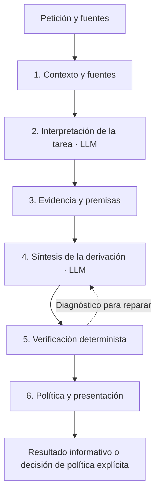

# Deltoryx Gate: arquitectura de seis capas

Estado: implementada en el recorrido público v4, 23 de noviembre de 2026. Contrato `gate-layers-1`. Es la única implementación de producto disponible. La evidencia de evaluación y sus limitaciones se publica por ejecución, separada de las comprobaciones de ingeniería.

La LLM responde de interpretar la afirmación, leer semánticamente las fuentes y construir la derivación adecuada. El núcleo responde de las referencias, los contratos formales y la ejecución de esa derivación. La aplicación responde de qué acciones permite con esas garantías.

Una derivación válida puede resolver una pregunta equivocada. El recibo identifica qué se interpretó y qué se comprobó; no convierte la ejecución correcta en certificación de la interpretación.

## Recorrido implementado

Las capas son módulos de la misma biblioteca; no son microservicios ni agentes adicionales. Una llamada al proveedor produce tarea, premisas y planes. El orquestador permite una reparación por defecto y conserva ambas propuestas, incluidas las defectuosas.

| Capa | Implementación | Artefacto | Garantía y responsabilidad |
| --- | --- | --- | --- |
| 1. Contexto | `context.py` | `ContextBundle` | Conserva afirmación original, fuentes, hashes, revisiones externas, rutas y coordenadas disponibles. No garantiza suficiencia ni verdad externa. |
| 2. Interpretación | `task_interpretation.py` | `TaskSpec` | Captura objetivos con sujeto, predicado, valor, polaridad, revisión, condiciones y alcance. La equivalencia con la afirmación original pertenece a la LLM. |
| 3. Premisas | `premise_builder.py` | `PremiseSet` | Distingue cita, extracción normalizada, presencia en diff e interpretación del modelo. Guarda lo admitido y rechazado. Una cita auténtica no certifica cualquier lectura del modelo. |
| 4. Síntesis | `plan_synthesis.py` | `DerivationPlan` | La LLM conecta premisas y operaciones para cada objetivo; declara carencias y operaciones propuestas. La pertinencia de la composición pertenece al modelo. |
| 5. Núcleo | `verification_core.py` | `VerificationReceipt` | Recomprueba referencias, dependencias, tipos, unidades, reglas, condiciones y ejecución. Compara con objetivos estructurados; no interpreta la afirmación original. |
| 6. Decisión | `decision_policy.py` | `DecisionReceipt` | Informa por defecto. Autorizar exige una política de aplicación explícita y vinculada a operación, payload y contexto. |

Los módulos se encuentran bajo `src/claimlayer/v4/`. `orchestration.py` coordina el recorrido y `planner.py` conserva la entrada pública. `deltoryx_gate.v4` reexporta la misma implementación, sin bifurcar el núcleo para Deltoryx Code.

## Contratos y procedencia

Cada artefacto incluye `schema_version`, `kind`, `artifact_id`, `content_digest`, `producer`, `parents` y `payload`. Su estado se conserva como JSON canónico inmutable. Las vistas devuelven copias; cambiar un objeto de entrada no cambia un recibo ya creado.

Los padres se identifican por ID y digest. Cambiar el contexto o la tarea invalida sus dependencias. El núcleo comprueba las relaciones y vuelve a obtener los datos desde sus referencias; no confía en un campo del modelo que diga «comprobado».

La revisión externa de una fuente —por ejemplo el SHA revisado— permanece separada del digest del documento entregado. Las citas por líneas usan coordenadas del documento desde 1; se conserva también el sistema de coordenadas original disponible. En código, ruta y SHA del hallazgo se entregan como contexto, no como etiquetas esperadas.

Los hashes acreditan identidad de contenido, no verdad ni autenticidad de emisor. Los nuevos artefactos no afirman estar firmados. La formalización y los recibos no reciben una probabilidad global sin calibración aplicable.

## Evidencia, interpretación y operaciones

Se distinguen cuatro clases de premisa:

- `quote`: fragmento original comprobado; predicado `text_span`.
- `diff_presence`: presencia de líneas comprobada contra el diff; predicado `text_present`.
- `literal`: valor contrastado mediante los normalizadores y comprobaciones de extracción existentes.
- `interpreted`: interpretación de la LLM con referencia comprobada; su valor permanece atribuido al modelo.

El núcleo vuelve a comprobar las referencias. Una premisa inválida afecta a los objetivos que dependen de ella; se conserva su diagnóstico aunque otros objetivos sean independientes.

`identity` preserva sujeto, predicado, condiciones y alcance. No transforma `text_present` en una afirmación sobre aserciones de tests. `count_lines` produce `line_count` del sujeto citado y registra el rango, filtro, lado del diff y convenio utilizados. La pertinencia semántica del bloque elegido sigue atribuida al modelo. Una dimensión incompatible o una unidad desconocida es un defecto formal, no una refutación del comentario.

Se reutilizan los catálogos, el lenguaje cerrado de expresiones y las obligaciones formales de v4. Las llamadas de semántica abierta se desactivan dentro del núcleo. No se ejecuta código libre propuesto por la LLM.

Las operaciones propuestas mediante expresiones quedan como composiciones elegidas por el modelo y ejecutadas por Deltoryx. Una operación sin expresión ejecutable queda pendiente como afirmación del modelo; no figura como un paso formal ejecutado. Su incorporación a un catálogo confiable requiere un proceso distinto.

El modelo puede equivocarse al elegir un objetivo, una premisa o una composición. La arquitectura hace atribuible ese fallo; no promete eliminarlo automáticamente.

## Estados y reparación

`VerificationReceipt.payload.goals` contiene el resultado por objetivo:

| Campo | Estados |
| --- | --- |
| `derivation_status` | `valid`, `invalid`, `incomplete`, `not_run` |
| `formal_comparison` | `satisfied`, `contradicted`, `undetermined`, `not_evaluated` |

El recibo agregado conserva objetivos, comprobaciones de evidencia, pasos recalculados, supuestos, carencias y errores. `semantic_coverage` permanece `not_assessed`: contar objetivos cubiertos no demuestra que la LLM no haya omitido una cláusula de la petición.

La tarea queda fijada durante la reparación del plan. Una reinterpretación debe ser explícita, genera otro artefacto e invalida sus dependencias sin ampliar el presupuesto. Un intento fallido no reutiliza un recibo exitoso de otro intento.

Cada error separa etapa, detector y responsable de reparación. La causa se marca como desconocida cuando no se ha determinado. Los errores del proveedor pertenecen a infraestructura; no significan ausencia de evidencia. Agotar intentos nunca convierte un plan en válido.

## Política predeterminada y autorización

Sin `ActionPolicy`, un resultado formal completo devuelve `INFORM`, `scope=report` y `authorized=false`, tanto si satisface como si contradice el objetivo. Los recorridos incompletos, inválidos o bloqueados terminan en `ESCALATE`, sin autorización. La reparación ocurre dentro del presupuesto del orquestador.

Una autorización `PASS` requiere una política explícita de aplicación con ID, versión, aceptación explícita de la interpretación del modelo, umbral de ejecución y digests de contexto y payload. Todos los objetivos deben estar satisfechos y cumplir ese umbral. Un error formal no puede ser compensado por pesos.

El recibo queda vinculado a la verificación y al contexto. Antes de consumir una autorización, `decision_is_current` comprueba además la operación y la política vigentes. El servicio permite instalar la política mediante `DELTORYX_ACTION_POLICY_FILE`; el cliente HTTP no puede suministrar su propia política.

Los recibos son decisiones, no ejecutan por sí mismos una acción externa. La explicación distingue interpretación atribuida, resultado formal y permiso operativo.

## Interfaz pública única

La biblioteca se publica como `deltoryx-gate` 4.0.0 y tiene un único contrato de producto, `gate-layers-1`. Los importadores `deltoryx_gate` y `claimlayer.v4` resuelven la misma implementación.

Las entradas son `claimlayer.v4.planner.verify_claim`, `POST /api/v1/v4/claims/verify` y el comando `deltoryx-gate verify-claim`. El almacén acepta exclusivamente recibos de este contrato y calcula sus métricas. No hay selector de versión, ruta alternativa ni fallback a otro motor.

Véase [contrato y ejemplos de integración](gate_layers_api.md).

## Evaluación y límites

Las comprobaciones de ingeniería validan contratos, referencias, aislamiento, unidades, hashes, autorización y transporte. No se presentan como calidad del producto.

Las evaluaciones nuevas entran por `verify_claim` o la API v4 con una LLM real que construye la derivación desde cero para cada afirmación y control. Se guardan propuestas defectuosas y reparaciones; se excluyen del contexto etiquetas esperadas, resultados anteriores y respuestas posteriores de autores. No se usan planes manuales, replays, respuestas cacheadas ni modelos simulados. Una caída del proveedor conserva lo completado y deja pendientes explícitos.

El conjunto inicial comprende doce casos OCR y catorce regresiones temporales conocidas. Son regresiones conocidas, no un nuevo conjunto independiente ni una demostración de generalización. La comprobación HTTP añade cuatro llamadas reales para validar el recorrido de servicio y persistencia. Su éxito de transporte se informa separado del acierto de los cálculos.

Para resultados y recibos de la plataforma, consultar `evidence/gate_layers/README.md`. La mejora de interpretación y la utilidad para decidir revisiones deben medirse; no se deducen de esta reorganización.
